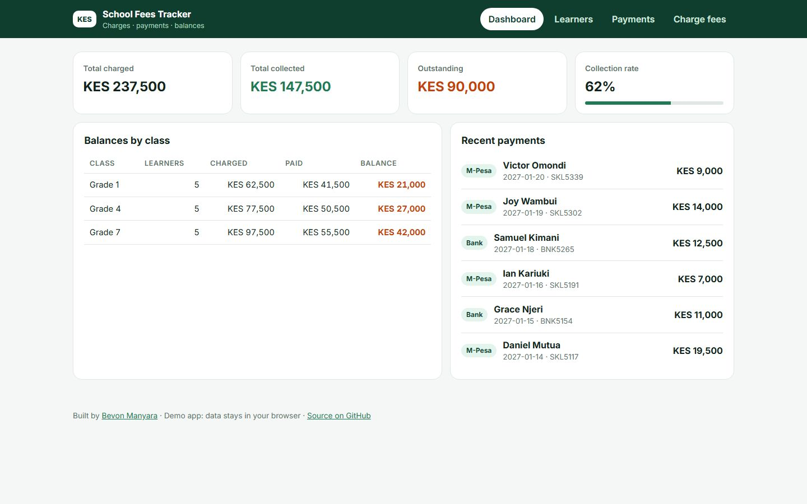

# School Fees Tracker

**Live demo (with sample data):** https://brivocc.github.io/school-fees-tracker/#demo

A browser app for small schools to track fees: learners, term charges, M-Pesa and bank payments, balances and printable statements.

## Features
- **Dashboard:** total charged, collected, outstanding, collection rate and balances by class
- **Learners:** add, search, filter by class or "owing only", remove
- **Charge fees to a whole class** in one step (e.g. "Term 1 2027 tuition")
- **Record payments** (M-Pesa, bank, cheque) with reference numbers and **duplicate-reference detection**
- **Printable fee statement** per learner with running balance
- **Export balances to CSV** (opens in Excel)
- Data saved in the browser (`localStorage`); no server or sign-up needed

## Tech
HTML, CSS and vanilla JavaScript. No dependencies.

## Run locally
Open `index.html` in a browser, then click **Load sample data** or start adding learners.

---
Built by **Bevon Manyara** · [Portfolio](https://brivocc.github.io) · Sample learners are fictional.
